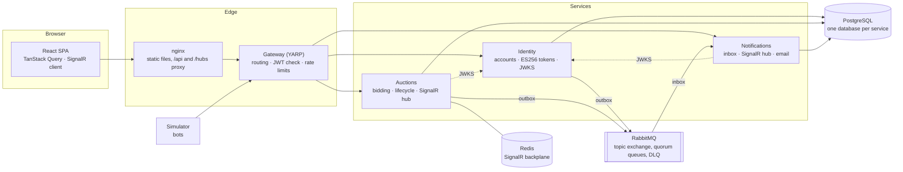

# Development guide

Architecture, configuration and testing notes for Gavel. Run commands from the repository root unless stated otherwise.

## Architecture



Three services, each owning its own database, behind one gateway ([ADR 0001](adr/0001-services-and-gateway.md)).
Identity signs ES256 access tokens and publishes its public key; the gateway and the services validate tokens locally
([ADR 0004](adr/0004-authentication.md)). For everything else the services exchange integration
events (`UserRegistered`, `BidderOutbid`, `AuctionEndingSoon`, `AuctionEnded`); the only direct call is fetching
Identity's public signing key.

```
backend/
  src/BuildingBlocks/       SharedKernel (Result, Error), Contracts (integration events), Messaging (outbox, inbox,
                            RabbitMQ), Persistence, ServiceDefaults (telemetry, health, security headers, JWT, errors)
  src/Services/Identity     vertical slices: Register, Login, RefreshSession, Logout, discovery (JWKS)
  src/Services/Auctions     Domain (Auction aggregate, proxy bidding) · Application (one Handler per use case)
                            · Infrastructure (EF Core, row locks) · Api (endpoints, SignalR hub, lifecycle worker)
  src/Services/Notifications  event handlers, notification API, SignalR hub, email dispatcher (MailKit)
  src/Gateway               YARP routes, rate-limit policies, forwarded headers
  src/Simulator             bots that list and bid through the public API
  src/AppHost               .NET Aspire orchestration for local development
  tests/                    domain unit tests, integration tests per service, gateway tests, shared TestKit
frontend/src/
  features/<feature>/       browse · auction · sell · activity · notifications · auth: pages, components, api.ts hooks
  components/               Countdown, PriceTicker, Paddle, LotArt, layout, ui primitives
  lib/                      API client and session refresh, SignalR connections, server clock, formatting
deploy/ · compose.yaml      PostgreSQL roles, docker compose stack
loadtest/                   k6 bidding scenario
docs/adr/                   architecture decision records
```

## Tech stack

| | |
|---|---|
| Backend | .NET 10, ASP.NET Core minimal APIs, EF Core 10 + Npgsql, FluentValidation, SignalR, YARP, MailKit, OpenTelemetry |
| Messaging | RabbitMQ (topic exchange, quorum queues with delivery limits and dead-lettering), transactional outbox and inbox |
| Data | PostgreSQL per service (snake_case, UUIDv7 keys, check constraints, `xmin` concurrency), Redis for the SignalR backplane |
| Frontend | React 19, TypeScript, Vite, Tailwind CSS 4, TanStack Query, React Router, React Hook Form + Zod, Radix UI, `@microsoft/signalr` |
| Testing | xUnit v3 on Microsoft Testing Platform, WebApplicationFactory, Testcontainers, Vitest, Testing Library, k6 |
| Quality | Nullable + warnings as errors, analyzers, `dotnet format`, oxlint, Prettier, NuGet lock files, CodeQL, Dependabot |
| Delivery | Multi-stage Docker builds on chiseled, non-root images, docker compose, nginx, .NET Aspire, GitHub Actions |

## Run it

**Everything in Docker** (only Docker needed):

```bash
cp .env.example .env              # then replace every change-me value
docker compose --profile demo up --build
# open http://localhost:8080 and click "Try the demo account"
```

The `demo` profile starts the simulator, which also creates the demo account. Without it you get an empty market.
Mail sent by the notifications service lands in Mailpit at http://localhost:8025, and the RabbitMQ console is at
http://localhost:15672. Everything is published on `127.0.0.1` only.

| Variable | |
|---|---|
| `POSTGRES_PASSWORD` | password of the `postgres` superuser, used only to create the databases |
| `IDENTITY_DB_PASSWORD` · `AUCTIONS_DB_PASSWORD` · `NOTIFICATIONS_DB_PASSWORD` | one non-superuser role per service, each owning only its own database (`deploy/postgres`) |
| `RABBITMQ_USER` · `RABBITMQ_PASSWORD` · `REDIS_PASSWORD` | broker and cache credentials |
| `JWT_SIGNING_KEY` | EC P-256 private key in PKCS#8, as PEM or base64. Generate one with `openssl genpkey -algorithm EC -pkeyopt ec_paramgen_curve:P-256 \| openssl pkcs8 -topk8 -nocrypt -outform DER \| base64 -w0`. Without it Identity makes a new key on every start and everyone is signed out |
| `SIMULATOR_BOT_PASSWORD` | fixed password for the bot accounts; random per run when empty |
| `PUBLIC_URL` · `WEB_PORT` | address used in email links, and the local port of the web app |
| `OTEL_EXPORTER_OTLP_ENDPOINT` | optional OpenTelemetry collector for traces and metrics |

Use letters, digits, `-` and `_` in passwords: they end up in connection strings and URIs. The databases and roles are
created the first time the `postgres-data` volume is initialised; after changing a database password run
`docker compose down -v`.

**Local development with .NET Aspire** (.NET 10 SDK, Node 24, Docker):

```bash
cd backend
dotnet run --project src/AppHost/Gavel.AppHost
```

The AppHost starts PostgreSQL, RabbitMQ, Redis and Mailpit in containers, runs every service, the simulator and the Vite
dev server, and opens the Aspire dashboard with logs, traces and metrics for all of them.

**Running the pieces yourself:** each service reads standard connection strings (`identitydb`, `auctionsdb`,
`notificationsdb`, `rabbitmq`, `redis`) and finds the others through `services__identity__http__0`-style variables. The
frontend proxies `/api` and `/hubs` to the gateway at `VITE_GATEWAY` (default `http://localhost:5100`):
`cd frontend && npm install && npm run dev`. In Development each service serves its API reference at `/docs`.

## Tests

```bash
cd backend && dotnet test         # starts PostgreSQL, RabbitMQ and Redis with Testcontainers
cd frontend && npm test
```

Already running the infrastructure? Set `GAVEL_TEST_POSTGRES`, `GAVEL_TEST_RABBITMQ` and `GAVEL_TEST_REDIS` and the
tests use it instead, each test class creating and dropping its own database and exchange.

Highlights:
- `Concurrent_bids_on_one_auction_are_applied_one_at_a_time`: 24 bidders at the same moment, one consistent price and history.
- Domain tests for proxy bidding: increments, ties, raising your own maximum, reserves, anti-sniping, closing outcomes.
- `Reusing_an_old_token_after_the_grace_period_revokes_every_session` and `Parallel_refreshes_with_one_token_never_fork_the_session`: refresh token theft detection and races.
- `Redelivered_messages_are_processed_once` and `Unreadable_messages_are_dead_lettered_and_do_not_block_the_queue`: inbox idempotency and the DLQ.
- `The_publisher_rests_while_there_is_nothing_to_send`: guards the outbox against busy-looping (a real bug found by load testing).
- `Parallel_guesses_cannot_get_past_the_account_limit` and `Parallel_listings_cannot_exceed_the_active_auction_limit`:
  limits that hold when requests race.
- Gateway tests against an echo service: routing, paths that must not be proxied, per-IP and per-user limits, forged tokens, headers.
- Frontend: bid form validation, live update merging, price series, schemas, session refresh and the API client.

CI runs the same suites plus `dotnet format --verify-no-changes`, oxlint, Prettier, type checks, `npm audit` and a
build of every container image.

## Load test

`loadtest/bidding.js` is a k6 scenario: a seller lists five lots, then up to 50 virtual bidders each register once and
keep reading a lot and bidding on it. It fails if more than 1% of requests error or if bid latency p95 goes above 250 ms.

```bash
docker compose -f compose.yaml -f loadtest/compose.loadtest.yaml --profile demo up -d --build
k6 run -e BASE_URL=http://localhost:8080 loadtest/bidding.js
```

The override raises the gateway's rate limits, which would otherwise (correctly) throttle 50 bidders from one IP.

## API

| Method | Path | |
|---|---|---|
| POST | `/api/auth/register` · `/login` · `/refresh` · `/logout` | sessions (refresh token in an HttpOnly cookie) |
| GET | `/api/auth/me` | current user |
| GET | `/api/auctions` | live, upcoming or ended lots; category, search, sort, paging |
| GET | `/api/auctions/stats` · `/rules` | market numbers for the home page · listing limits for the sell form |
| GET | `/api/auctions/{id}` · `/{id}/bids` | details with the viewer's own standing · bid history |
| POST | `/api/auctions` · `/{id}/bids` · `/{id}/cancel` | list an item · place or raise a maximum bid · withdraw before the first bid |
| PUT / DELETE | `/api/auctions/{id}/watch` | watchlist |
| GET | `/api/me/bids` · `/api/me/auctions` · `/api/me/watchlist` | my activity |
| GET / POST | `/api/notifications` · `/{id}/read` · `/read-all` | notification centre |
| WS | `/hubs/auctions` · `/hubs/notifications` | live auction updates (anonymous) · personal notifications (signed in) |

Errors are [RFC 9457 problem details](https://www.rfc-editor.org/rfc/rfc9457) with a stable `code` (e.g. `Bid.TooLow`).

## Security

| Area | Protection |
|---|---|
| Tokens | ES256 only, signed by Identity and validated everywhere against its JWKS; issuer, audience, lifetime and signature checked. Claims are the user id, display name and token id. No email |
| Sessions | Access tokens live in memory. Refresh tokens are `HttpOnly; Secure; SameSite=Strict; Path=/api/auth` cookies, stored hashed, rotated on every use and capped at 30 days. Reusing a rotated token after a 30-second grace window revokes every session of that user |
| Passwords | PBKDF2-SHA512 with 210,000 iterations; per-account throttling of failed sign-ins on top of per-IP limits |
| Access | Every endpoint and hub requires a signed-in user unless it opts out. Seller-only and owner-only actions are checked in the handlers, and covered by tests. Notification connections are closed when their token expires |
| Privacy | Bidders are shown as paddle numbers. The reserve price is returned only to the seller. Notifications are delivered only to their owner's SignalR group |
| Input | FluentValidation and domain invariants on every command, database check constraints underneath. EF Core parameterises every query, including the raw row-lock SQL. Control characters are rejected in titles and descriptions; email bodies are HTML-encoded |
| Abuse | Gateway rate limits per IP for sign-in and session refresh, per user for bids, listings and the rest of the API. 64 KB request body limit |
| Messaging | Inbox de-duplication, a delivery limit per message and a dead-letter queue, so a poison message cannot block a queue |
| Headers | API: `default-src 'none'` CSP, `nosniff`, `DENY`, `no-store`, no `Server` header. Web: strict CSP (`script-src 'self'`), `Permissions-Policy`, COOP. WebSocket requests are not access-logged because SignalR puts the token in the query string |
| Containers | Services run on chiseled non-root images with read-only file systems, all capabilities dropped and `no-new-privileges`. Only nginx, Mailpit and the RabbitMQ console are published, on `127.0.0.1` |

TLS and HSTS belong to the reverse proxy in front of the stack. [SECURITY.md](../SECURITY.md) covers deployment advice,
known trade-offs and how to report a vulnerability.
